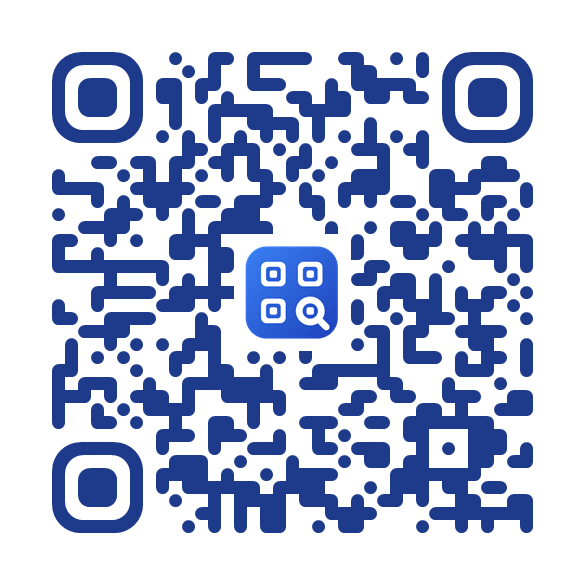
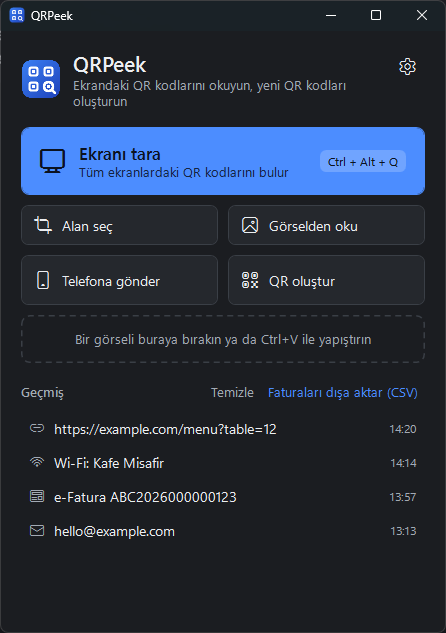
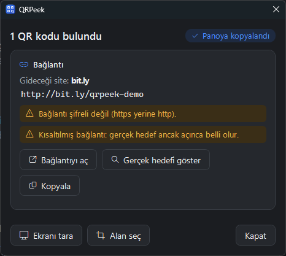
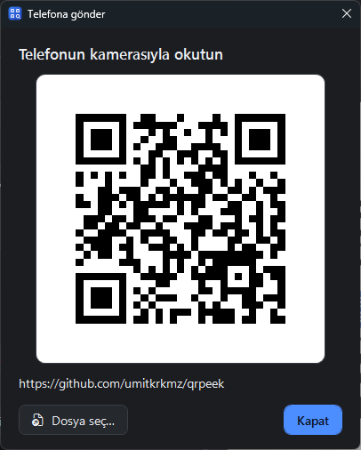
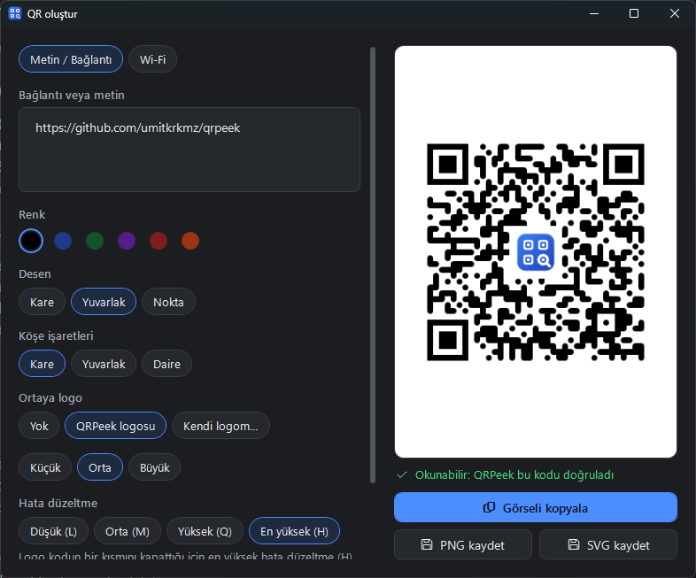
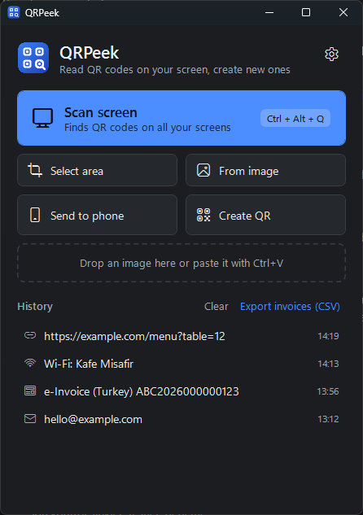
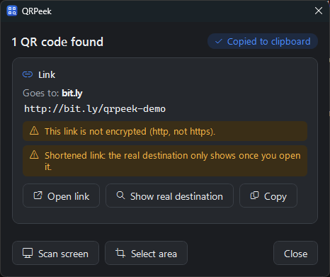

# QRPeek

[](https://github.com/umitkrkmz/qrpeek/actions/workflows/tests.yml)
[](https://github.com/umitkrkmz/qrpeek/releases/latest)
[](LICENSE)

**[🇹🇷 Türkçe](#türkçe) · [🇬🇧 English](#english)** · **[Changelog](CHANGELOG.md)** · **[Gizlilik / Privacy](docs/PRIVACY.md)**

Ekrandaki QR kodlarını **kamera ya da telefon olmadan** okuyan, QR kodu oluşturan küçük bir Windows aracı.
A small Windows tool that reads QR codes **on your screen**, with no camera or phone, and creates them.

<p align="center">
  
  <br>
  <sub>QRPeek kuruluysa <b>Ctrl + Alt + Q</b>'ya basın, bu kod ekrandan okunsun. · With QRPeek installed, press <b>Ctrl + Alt + Q</b> to read this code right off the screen.</sub>
  <br>
  <sub>Bu kod QRPeek'in kendi üreticisiyle yapıldı. · Made with QRPeek's own generator.</sub>
</p>

<table>
  <tr>
    <td></td>
    <td></td>
  </tr>
  <tr>
    <td></td>
    <td></td>
  </tr>
</table>

<details>
<summary>English screenshots</summary>

<table>
  <tr>
    <td></td>
    <td></td>
  </tr>
  <tr>
    <td></td>
    <td></td>
  </tr>
</table>

</details>

---

## Türkçe

### Öne çıkanlar

- **Tek kısayol, tüm ekranlar:** `Ctrl + Alt + Q` ile tüm monitörler taranır; alan seçmeye gerek yok, ekrandaki kodların hepsi bulunur. Kod çok küçükse ekran donar, etrafını sürükleyip seçersiniz. Tarayıcıda küçülmüş yoğun kodlar (ör. e-Arşiv faturası) da okunur.
- **Güvenli bağlantılar:** hiçbir şey kendiliğinden açılmaz. Önce gideceği site gösterilir; şifresiz (http) bağlantı, IP adresi, kısaltılmış link, sahte görünümlü alan adı ve `@` hilesi için uyarı verilir. "Gerçek hedefi göster", `bit.ly` gibi linklerin nereye gittiğini tarayıcı açmadan bulur.
- **Telefona gönder (`Ctrl + Alt + W`):** kopyaladığınız link ya da metin anında büyük bir QR olur, telefonun kamerasıyla okutursunuz. Dosya, fotoğraf ve uzun metinler **yerel ağ üzerinden**, tek kullanımlık ve 10 dakika geçerli bir linkle gider; buluta yükleme yok.
- **Akıllı kartlar:** Wi-Fi (tek tıkla bağlan, şifreyi kopyala), 2FA kurulum kodu (anahtar maskeli, geçmişe yazılmaz), e-Fatura / e-Arşiv (VKN, tarih, KDV, ödenecek tutar; Excel'e CSV), e-posta, telefon, SMS, kişi (.vcf), konum.
- **QR oluşturucu:** metin, bağlantı ya da Wi-Fi; renk, desen (kare, yuvarlak, nokta), köşe işaretleri, ortaya QRPeek logosu ya da kendi logonuz. Her kod tasarlanırken QRPeek tarafından okunarak doğrulanır. PNG, SVG ya da panoya.
- **Ekranı izleme modu (isteğe bağlı):** sunumda, toplantıda ya da videoda bir QR belirince sağ altta küçük bir uyarı çıkar; Rahatsız Etmeyin modunda da çalışır.
- **Görselden okuma:** sürükle-bırak, `Ctrl + V` ya da dosya seçerek.
- **Küçük ve kurulumsuz:** yaklaşık 1 MB; Windows 10/11'de hazır gelen .NET Framework 4.8 ile çalışır. Türkçe ve İngilizce, açık ve koyu tema.

### İndir

- **GitHub (ücretsiz):** **[⬇ QRPeek-portable.zip](https://github.com/umitkrkmz/qrpeek/releases/latest/download/QRPeek-portable.zip)**. Bir klasöre çıkarın, `QRPeek.exe`'yi çalıştırın; kurulum gerekmez. Windows "Windows bilgisayarınızı korudu" derse **Ek bilgi → Yine de çalıştır**'a tıklayın (dosya henüz kod imzalı değil). Buradaki sürüm ücretsizdir ve öyle kalacak.
- **Microsoft Store (ücretli, yakında):** aynı uygulama; tek tıkla kurulum, SmartScreen uyarısı yok, güncellemeler kendiliğinden gelir. Satın almak projeye destek olur. Özellikler aynıdır.

### Güvenli mi?

- Kaynak kodu açıktır. GitHub sürümündeki her ZIP, bu depodaki koddan **GitHub Actions** ile derlenir; SHA256 özeti sürüm notlarında yazar (`Get-FileHash .\QRPeek-portable.zip` ile karşılaştırın).
- Telemetri, hesap, reklam yok. Ekran görüntüleri yalnızca bellekte işlenir, kaydedilmez ve gönderilmez. Ayrıntılar: **[Gizlilik politikası](docs/PRIVACY.md#türkçe)**.
- Bir açık bulursanız lütfen herkese açık issue yerine **[SECURITY.md](SECURITY.md)**'deki yoldan bildirin.

### Bilinen kısıtlar

- Çoklu monitör ve monitörler arasında farklı ölçekleme (ör. %100 + %150) henüz test edilmedi. Uygulama monitör başına DPI uyumlu yazıldı; bu kurulumlarda bir sorun görürseniz lütfen [bildirin](https://github.com/umitkrkmz/qrpeek/issues/new/choose).

### Kaynaktan derleme

```bash
dotnet build -c Release
dotnet test
```

.NET SDK 8 veya üstü gerekir; Visual Studio gerekmez. Çıktı: `src/QRPeek/bin/Release/net48/`. Katkı için: **[CONTRIBUTING.md](CONTRIBUTING.md)** · **[Davranış Kuralları](CODE_OF_CONDUCT.md)**.

---

## English

### Highlights

- **One shortcut, every screen:** `Ctrl + Alt + Q` scans all monitors; no need to select an area, every code on screen is found. If a code is too small, the screen freezes and you drag around it. Dense codes shrunk by the browser (like Turkish e-invoices) are read too.
- **Safe links:** nothing opens on its own. You see the real destination first, with warnings for plain http, bare IP addresses, URL shorteners, look-alike domains and the `@` trick. "Show real destination" finds where a `bit.ly`-style link goes, without opening a browser.
- **Send to phone (`Ctrl + Alt + W`):** a copied link or text becomes a big QR; point your phone's camera at it. Files, photos and long text go **over the local network** through a one-off link valid for 10 minutes; nothing is uploaded to the cloud.
- **Smart cards:** Wi-Fi (join in one click, copy the password), 2FA setup codes (masked key, never written to history), Turkish e-Fatura / e-Arşiv invoices (tax IDs, date, VAT, amount due; CSV for Excel), email, phone, SMS, contact (.vcf), location.
- **QR generator:** text, link or Wi-Fi; color, pattern (square, rounded, dots), corner markers, the QRPeek logo or your own in the middle. Every code is read back by QRPeek as you design it. PNG, SVG or clipboard.
- **Watch mode (optional):** when a QR code appears in a presentation, meeting or video, a small pop-up shows up bottom-right; works with Do Not Disturb on.
- **From images:** drag and drop, `Ctrl + V`, or pick a file.
- **Small, nothing to install:** about 1 MB; runs on the .NET Framework 4.8 that ships with Windows 10/11. Turkish and English, light and dark theme.

### Download

- **GitHub (free):** **[⬇ QRPeek-portable.zip](https://github.com/umitkrkmz/qrpeek/releases/latest/download/QRPeek-portable.zip)**. Extract it to a folder and run `QRPeek.exe`; nothing to install. If Windows says "Windows protected your PC", click **More info → Run anyway** (the file isn't code-signed yet). The version here is free and will stay free.
- **Microsoft Store (paid, coming soon):** the same app with a one-click install, no SmartScreen warning, and automatic updates. Buying it supports the project. The features are the same.

### Is it safe?

- The source is open. Every ZIP on GitHub is built from this repository's code by **GitHub Actions**; its SHA256 is in the release notes (compare with `Get-FileHash .\QRPeek-portable.zip`).
- No telemetry, accounts or ads. Screen captures are processed in memory only, never saved or sent. Details: **[Privacy policy](docs/PRIVACY.md#english)**.
- If you find a vulnerability, please report it through **[SECURITY.md](SECURITY.md)** rather than a public issue.

### Known limitations

- Multiple monitors and mixed scaling between monitors (e.g. 100% + 150%) have not been tested yet. The app is written to be per-monitor DPI aware; if you see a problem on such a setup, please [report it](https://github.com/umitkrkmz/qrpeek/issues/new/choose).

### Build from source

```bash
dotnet build -c Release
dotnet test
```

Needs the .NET SDK 8 or later; Visual Studio is not required. Output: `src/QRPeek/bin/Release/net48/`. To contribute: **[CONTRIBUTING.md](CONTRIBUTING.md)** · **[Code of Conduct](CODE_OF_CONDUCT.md)**.

---

## Lisans / License

QRPeek is free software under the [GNU General Public License v3.0 or later](LICENSE). Third-party libraries (ZXing.Net, Apache-2.0; QRCoder, MIT) are listed in [THIRD-PARTY-NOTICES.txt](THIRD-PARTY-NOTICES.txt).

The **QRPeek name and logo are not covered by the GPL**. Forks are welcome under the GPL, but please publish them under a different name and icon.

QRPeek adı ve logosu GPL kapsamında değildir. GPL'e uygun çatallamalara açığız, ancak lütfen farklı bir ad ve simgeyle yayınlayın.
