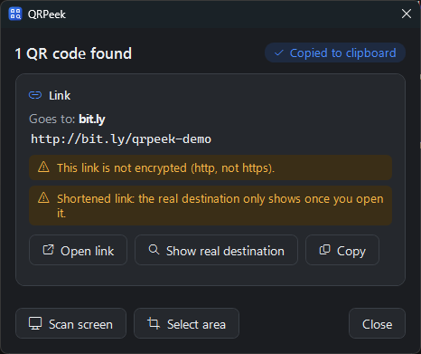
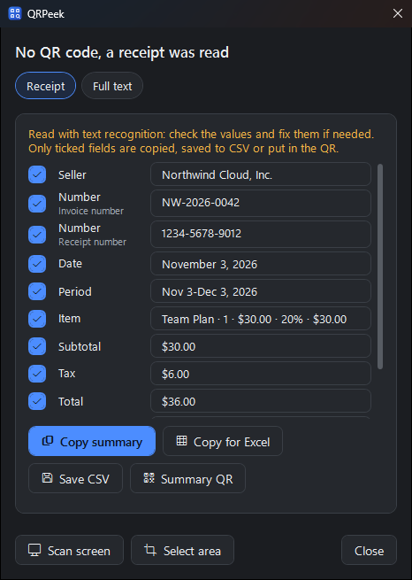
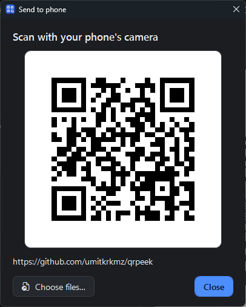
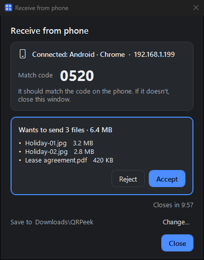
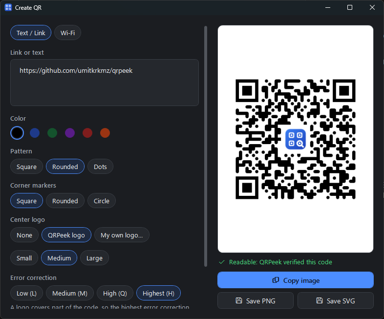
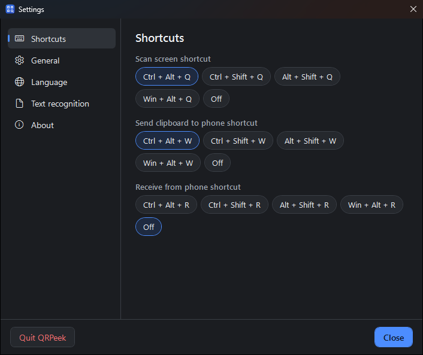

# QRPeek guide

[Türkçe](README.tr.md) · **English** · [← Home](../README.md)

QRPeek reads the QR codes you see on your screen without a camera or phone: on a web page, in a PDF, in a meeting presentation, in a video or in an image. It also creates QR codes, swaps files with your phone, and reads the text of receipts that have no QR code.

## Contents

- [Download and install](#download-and-install)
- [Shortcuts and menu](#shortcuts-and-menu)
- [Reading QR codes](#reading-qr-codes)
- [Cards: what a code means](#cards-what-a-code-means)
- [No QR? Text recognition (OCR)](#no-qr-text-recognition-ocr)
- [Receipt card](#receipt-card)
- [Receipt terms](#receipt-terms)
- [Send to phone](#send-to-phone)
- [Receive from phone](#receive-from-phone)
- [QR generator](#qr-generator)
- [Settings](#settings)
- [Privacy and security](#privacy-and-security)
- [Known limitations](#known-limitations)
- [Build from source](#build-from-source)

## Download and install

<a href="https://apps.microsoft.com/detail/9nx5t90f6dqk?referrer=appbadge&mode=direct"></a>

- **Microsoft Store (paid):** one-click install, no SmartScreen warning, automatic updates. Buying it supports the project.
- **GitHub (free):** **[⬇ QRPeek-portable.zip](https://github.com/umitkrkmz/qrpeek/releases/latest/download/QRPeek-portable.zip)**. Extract it to a folder and run `QRPeek.exe`; nothing to install. If Windows says "Windows protected your PC", click **More info → Run anyway** (the file isn't code-signed yet). This version is free and will stay free.

Both have the same features. The GitHub build can ask GitHub once a day whether a new version exists; the Store version gets its updates from the Store.

**Requirements:** Windows 10 (version 2004 or later) or Windows 11. Runs on the .NET Framework 4.8 that ships with Windows; downloads nothing extra and takes a few MB.

## Shortcuts and menu

| Shortcut | What it does |
|---|---|
| `Ctrl + Alt + Q` | Scans every screen and shows the codes found |
| `Ctrl + Alt + W` | Sends the link, text or file on the clipboard to your phone |
| (off) | Opens Receive from phone; assign a key such as `Ctrl + Alt + R` in Settings → Shortcuts |
| `Ctrl + V` (in the main window) | Reads the image on the clipboard |

Shortcuts can be changed in Settings → Shortcuts; you're told if another app already uses the key.

QRPeek keeps waiting in the notification area after you close its window. Right-click the icon for **Scan screen, Select area, Read image on clipboard, Watch screen, Send to phone, Receive from phone, Create QR, Settings** and **Quit QRPeek**.

## Reading QR codes

- **Every screen:** `Ctrl + Alt + Q` scans all monitors and finds every code on screen. With more than one screen, it also says which one the code was on ("On the left screen").
- **Select area:** if nothing is found or a code is too small, the screen freezes and you drag around the code. Small areas are enlarged before reading; dense codes shrunk by the browser (like Turkish e-invoices) are read too.
- **From images:** drop an image on the main window, paste it with `Ctrl + V`, or pick a file.
- **Watch mode (optional):** when it's on and a QR code appears in a presentation, meeting or video, a small pop-up shows up bottom-right. Works with Do Not Disturb on; codes in QRPeek's own windows don't count.
- **Clipboard:** when one code is found, its content is copied automatically (can be turned off in Settings). 2FA codes and Wi-Fi passwords are never copied on their own.

## Cards: what a code means



- **Link:** nothing opens on its own. The site it goes to is shown in bold first, with warnings for plain http, bare IP addresses, URL shorteners, domains imitating a familiar site with non-Latin letters, and the `@` trick. **Show real destination** follows the redirects of a `bit.ly`-style link one by one, without opening a browser. If a site blocks the automatic check (e.g. Cloudflare), it says so plainly and shows how far it could follow.
- **Wi-Fi:** join in one click; QRPeek waits until the connection is really up. The password stays hidden until you ask, and copying it keeps it out of clipboard history. Windows may ask for location access while joining ([why?](PRIVACY.md#english)).
- **2FA setup code:** the secret key is masked, never written to history and never copied on its own.
- **Turkish e-invoice (e-Fatura / e-Arşiv):** tax IDs, date, VAT and amount due in a tidy card. Invoices in the history export to Excel (CSV) in one click.
- **Others:** email, phone, SMS, contact card (saved as .vcf), location. QRPeek's own [receipt summary QR](#receipt-card) opens as a receipt card again.

A QR code can only ever open `http(s)`, `mailto`, `tel` and `sms` links; it can never run anything like `file:` or `javascript:`.

## No QR? Text recognition (OCR)

If the area or image you pick has no QR code, its text is read **on this PC with the text recognition built into Windows**. No internet, nothing to download.

- The text comes in an editable box. Items on the same row stay together, with columns separated by spaces.
- **Copy text**, **Copy for Excel** (columns paste as cells) and **Make QR** (opens the text in the QR generator).
- The language follows the text recognition languages installed in Windows; with several, the image is read with each and the reading that knows the most invoice labels wins. Turkish letters (ü, ş, ğ, İ…) are kept.
- The text is **never written to history** and **never copied on its own**; what's on your screen is none of QRPeek's business.

> **Check it:** text recognition isn't perfect. In codes that mix letters and digits, `1` and `I` can swap, and small marks like `/` can get lost. Check important values before you copy them; the box is editable for that.

## Receipt card



When the text is a receipt or invoice (e.g. an online subscription invoice), QRPeek picks out its fields and shows two tabs: **Receipt** and **Full text**.

- **Fields:** seller, number, date, period, items, subtotal, tax, total, buyer, payment, tax ID. When a receipt has several numbers or dates ("Invoice number", "Receipt number"), each comes with its own label.
- **Picking:** every field has a checkbox. Only ticked fields are copied, saved to CSV or put in the QR. Your picks are remembered for the next receipt.
- **Personal details:** buyer, e-mail and payment start **unticked**; tick them if you want them.
- **Secrets:** product keys and card numbers are **masked** (`•••• 1111`), can't be ticked and never get into any output.
- **Outputs:** **Copy summary**, **Copy for Excel**, **Save CSV** and **Summary QR**.

**Summary QR** turns the fields you picked into a plain-text QR code that any phone camera can read. Its first line says "QRPeek receipt summary" and its last "(Not an official document.)"; it has no e-invoice field names and nothing that could pass as an official document. When QRPeek reads such a QR (even one made on another PC, in the other language), it opens it as a receipt card again. A hand-made "summary" goes through the same rules: product keys are dropped, card numbers masked.

Values come from text recognition, so they're **always editable**; if a field was misread, fix it in its box.

## Receipt terms

The receipt card recognizes invoice labels (Invoice number, Amount paid, VAT, Subtotal…) through a dictionary. The dictionary isn't tied to a language; Turkish and English are built in. It also fixes the mistakes text recognition makes in labels: it joins split words ("Invoice n um ber") and repairs small typos ("Arnount" → "Amount"). It **never touches values** such as names, addresses or numbers.

For another language or your own labels: **Settings → Text recognition → Receipt terms → Edit**. The format is simple, one field per line:

```
[total] Gesamtbetrag, Summe, Zu zahlen
[tax] MwSt., USt.
[secret] Produktschlüssel, Lizenzschlüssel
```

- Bad lines and unknown field names are shown as you type.
- Import and export the list as `.txt`.
- **Copy prompt for an AI** gives a ready-made prompt to ask an AI of your choice for another language's list. Paste the answer as it is; code blocks and bullet points are ignored. QRPeek itself doesn't connect anywhere.
- Fields: `document, number, date, seller, buyer, item, qty, unitprice, amount, subtotal, tax, taxid, total, payment, period, secret`. `[secret]` is for labels of codes that must be kept private, such as product keys.

## Send to phone



Press `Ctrl + Alt + W`: the link or text you copied becomes a big QR code; point your phone's camera at it.

Files, photos and long text travel **over your local network only**: QRPeek opens a one-off, unguessable address that's valid for 10 minutes. The phone must be on the same network. Nothing is uploaded to the cloud; the server only serves the files you picked, read-only. Windows Firewall may ask for permission the first time.

## Receive from phone



Get photos and files from a phone or tablet onto the PC with nothing to install on the device:

1. Open **Receive from phone** from the **Phone: send / receive** button in the main window or from the notification area menu.
2. The phone scans the QR code on screen and picks files.
3. The PC shows the list of files it wants to send. **Nothing is received until you accept.**

- The first device to connect holds the session; no other device can step in.
- Files are saved to **Downloads\QRPeek** by default (change it in the window). Existing files are never overwritten.
- Saved files are marked as coming from the internet, and **nothing opens on its own**.
- It works over the local network only and only while the window is open; it closes on its own when idle.

## QR generator



- Text, link or Wi-Fi (network name, password, security type, hidden network).
- Color, pattern (square, rounded, dots), corner markers; the QRPeek logo or your own in the middle.
- QRPeek **reads every code back** as you design it, so you never print a code that doesn't scan.
- PNG, SVG or clipboard.

## Settings



- **Shortcuts:** scan, send to phone, receive from phone.
- **General:** copy to the clipboard when one code is found, keep a history (on this PC only), watch the screen, start in the background with Windows, (GitHub build) check for new versions.
- **Language:** Türkçe, English, or the system language.
- **Text recognition:** receipt terms.
- **About:** version, source code, third-party licenses, privacy policy.

## Privacy and security

- No account, ads or telemetry. Screen captures are processed in memory only; never saved, never sent.
- QRPeek never goes online on its own. It only uses the network when you ask: "Show real destination", sending to / receiving from your phone (local network only), and the optional version check in the GitHub build.
- History and settings stay on this PC, in `%LOCALAPPDATA%\QRPeek`. 2FA codes and Wi-Fi passwords are never written to history.
- Every ZIP on GitHub is built from this repository's code by **GitHub Actions**; its SHA256 is in the release notes (compare with `Get-FileHash .\QRPeek-portable.zip`).

Details: **[Privacy policy](PRIVACY.md#english)**. If you find a vulnerability, please report it through **[SECURITY.md](../SECURITY.md)** rather than a public issue.

## Known limitations

- Text recognition isn't perfect: in codes that mix letters and digits `1` / `I` can swap, and small marks like `/` can get lost. That's why values are always editable.
- The receipt card makes educated guesses; with a layout it doesn't know, it leaves a field empty rather than filling it wrong. The full text is always in the second tab.
- Not yet tested on ARM64 Windows 11 PCs (e.g. Snapdragon X). The app is built CPU-independent, so it's expected to run there; if you see a problem, please report it.

## Build from source

```bash
dotnet build -c Release
dotnet test
```

Needs the .NET SDK 8 or later; Visual Studio is not required. Output: `src/QRPeek/bin/Release/net48/`. To contribute: **[CONTRIBUTING.md](../CONTRIBUTING.md)** · **[Code of Conduct](../CODE_OF_CONDUCT.md)** · **[Changelog](../CHANGELOG.md)**.
