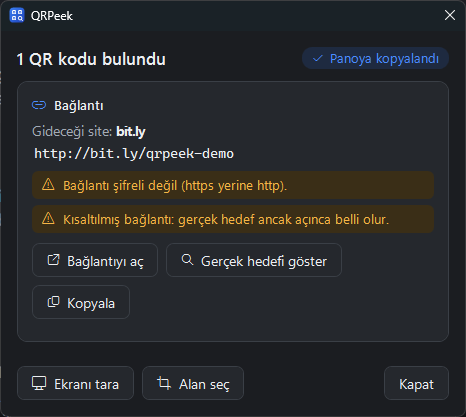
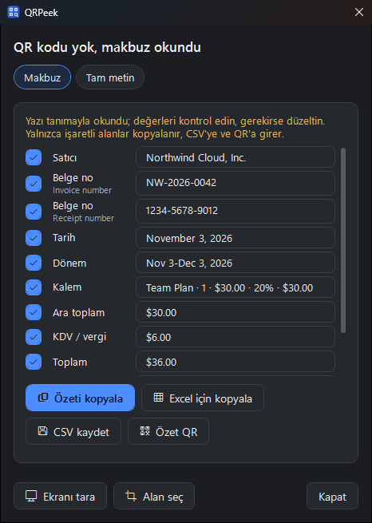
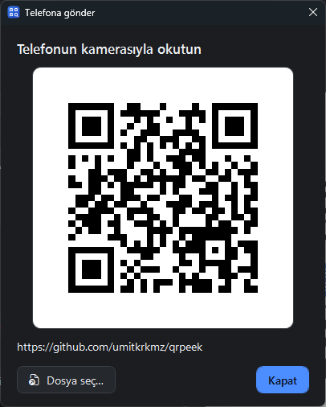
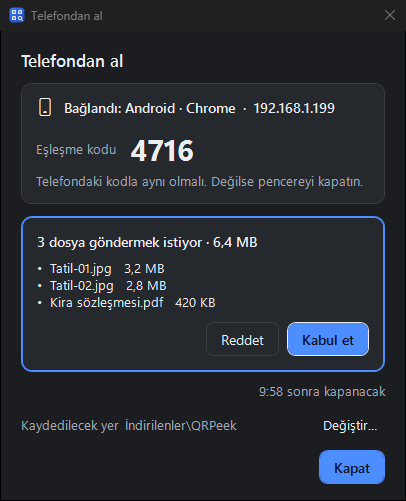
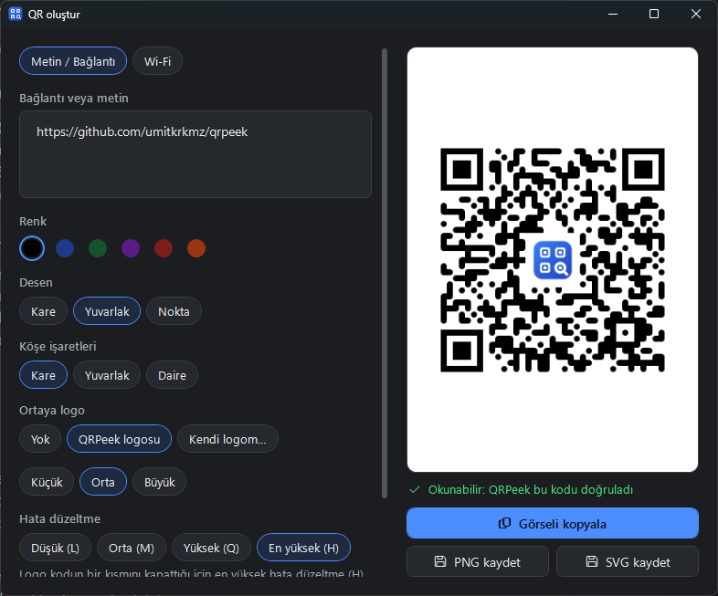
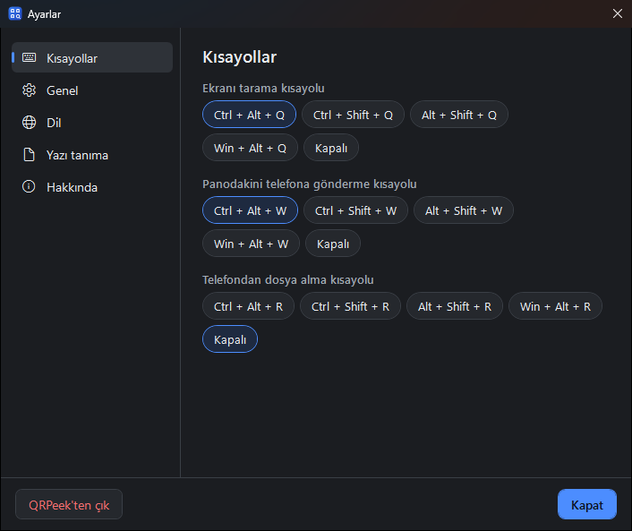

# QRPeek kılavuzu

**Türkçe** · [English](README.en.md) · [← Ana sayfa](../README.md)

QRPeek, ekranınızda gördüğünüz QR kodlarını kamera ya da telefon olmadan okur: bir web sayfasında, PDF'te, toplantı sunumunda, videoda ya da bir görselde. QR kodu da oluşturur, telefonla dosya alıp verir ve QR'ı olmayan makbuzlardaki yazıyı okur.

## İçindekiler

- [Kurulum ve indirme](#kurulum-ve-indirme)
- [Kısayollar ve menü](#kısayollar-ve-menü)
- [QR okuma](#qr-okuma)
- [Kartlar: okunan kod ne anlama geliyor?](#kartlar-okunan-kod-ne-anlama-geliyor)
- [QR yoksa: yazı tanıma (OCR)](#qr-yoksa-yazı-tanıma-ocr)
- [Makbuz kartı](#makbuz-kartı)
- [Fatura sözlüğü](#fatura-sözlüğü)
- [Telefona gönder](#telefona-gönder)
- [Telefondan al](#telefondan-al)
- [QR oluşturucu](#qr-oluşturucu)
- [Ayarlar](#ayarlar)
- [Gizlilik ve güvenlik](#gizlilik-ve-güvenlik)
- [Bilinen kısıtlar](#bilinen-kısıtlar)
- [Kaynaktan derleme](#kaynaktan-derleme)

## Kurulum ve indirme

<a href="https://apps.microsoft.com/detail/9nx5t90f6dqk?referrer=appbadge&mode=direct"></a>

- **Microsoft Store (ücretli):** tek tıkla kurulum, SmartScreen uyarısı yok, güncellemeler kendiliğinden gelir. Satın almak projeye destek olur.
- **GitHub (ücretsiz):** **[⬇ QRPeek-portable.zip](https://github.com/umitkrkmz/qrpeek/releases/latest/download/QRPeek-portable.zip)**. Bir klasöre çıkarın, `QRPeek.exe`'yi çalıştırın; kurulum gerekmez. Windows "Windows bilgisayarınızı korudu" derse **Ek bilgi → Yine de çalıştır**'a tıklayın (dosya henüz kod imzalı değil). Bu sürüm ücretsizdir ve öyle kalacak.

İki sürümün özellikleri aynıdır. GitHub sürümü isterseniz günde bir kez yeni sürüm olup olmadığını sorar; Store sürümü güncellemeleri Store'dan alır.

**Gereksinimler:** Windows 10 (2004 ve sonrası) ya da Windows 11. Windows'ta hazır gelen .NET Framework 4.8 ile çalışır; ek bir şey indirmez, birkaç MB yer kaplar.

## Kısayollar ve menü

| Kısayol | Ne yapar |
|---|---|
| `Ctrl + Alt + Q` | Tüm ekranları tarar, bulunan kodları gösterir |
| `Ctrl + Alt + W` | Panodaki link, metin ya da dosyayı telefona gönderir |
| (kapalı) | Telefondan al penceresini açar; Ayarlar → Kısayollar'dan `Ctrl + Alt + R` gibi bir tuş atanabilir |
| `Ctrl + V` (ana pencerede) | Panodaki görseli okur |

Kısayollar Ayarlar → Kısayollar'dan değiştirilebilir; başka bir uygulama aynı tuşu kullanıyorsa uyarılır.

QRPeek pencereyi kapatınca bildirim alanında beklemeye devam eder. Simgeye sağ tıklayınca **Ekranı tara, Alan seç, Panodaki görseli oku, Ekranı izle, Telefona gönder, Telefondan al, QR oluştur, Ayarlar** ve **QRPeek'ten çık** gelir.

## QR okuma

- **Tüm ekranlar:** `Ctrl + Alt + Q` bütün monitörleri tarar ve ekrandaki kodların hepsini bulur. Birden çok ekranınız varsa kodun hangisinde olduğu da yazar ("Soldaki ekranda").
- **Alan seç:** kod bulunamazsa ya da çok küçükse ekran donar, kodun etrafını sürükleyip seçersiniz. Küçük alanlar okunmadan önce büyütülür; tarayıcıda küçülmüş yoğun kodlar (ör. e-Arşiv faturası) da okunur.
- **Görselden:** bir görseli ana pencereye sürükleyip bırakın, `Ctrl + V` ile yapıştırın ya da dosya seçin.
- **Ekranı izleme (isteğe bağlı):** açıksa sunumda, toplantıda ya da videoda bir QR belirince sağ altta küçük bir uyarı çıkar. Rahatsız Etmeyin modunda da çalışır; QRPeek'in kendi pencerelerindeki kodları saymaz.
- **Panoya kopyalama:** tek kod bulunduğunda içeriği kendiliğinden panoya kopyalanır (Ayarlar'dan kapatılabilir). 2FA kodları ve Wi-Fi şifreleri asla kendiliğinden kopyalanmaz.

## Kartlar: okunan kod ne anlama geliyor?



- **Bağlantı:** hiçbir şey kendiliğinden açılmaz. Önce gideceği site kalın harflerle gösterilir. Şifresiz (http) bağlantı, IP adresi, kısaltılmış link, Latin dışı harflerle taklit edilen alan adı ve `@` hilesi için uyarı çıkar. **Gerçek hedefi göster**, `bit.ly` gibi linklerin nereye gittiğini tarayıcı açmadan, yönlendirmeleri tek tek izleyerek bulur. Bir site otomatik denetimi engellerse (ör. Cloudflare) bunu açıkça söyler ve nereye kadar izlenebildiğini gösterir.
- **Wi-Fi:** tek tıkla bağlanın; QRPeek bağlantının gerçekten kurulduğunu bekleyip doğrular. Şifre siz isteyene kadar gizli kalır, kopyalanırsa pano geçmişine girmez. Bağlanırken Windows konum izni isteyebilir ([neden?](PRIVACY.md#türkçe)).
- **2FA kurulum kodu:** gizli anahtar maskelenir, geçmişe yazılmaz, kendiliğinden kopyalanmaz.
- **e-Fatura / e-Arşiv:** satıcı ve alıcı VKN, tarih, KDV ve ödenecek tutar düzenli bir kartta. Geçmişteki faturalar tek tıkla Excel'e (CSV) aktarılır.
- **Diğer:** e-posta, telefon, SMS, kişi kartı (.vcf olarak kaydedilir), konum. QRPeek'in kendi [makbuz özeti QR'ı](#makbuz-kartı) yeniden makbuz kartı olarak açılır.

Bir QR kodu yalnızca `http(s)`, `mailto`, `tel` ve `sms` bağlantılarını açabilir; `file:`, `javascript:` gibi bir şeyi asla çalıştıramaz.

<br clear="right">

## QR yoksa: yazı tanıma (OCR)

Seçtiğiniz alanda ya da görselde QR kodu yoksa içindeki yazı **Windows'un yerleşik yazı tanıma özelliğiyle, bu bilgisayarda** okunur. İnternet yok, ek indirme yok.

- Yazı düzenlenebilir bir kutuda gelir. Aynı satırdaki bilgiler bir arada kalır, sütunlar boşlukla ayrılır.
- **Metni kopyala**, **Excel için kopyala** (sütunlar hücrelere bölünür) ve **QR yap** (metni QR oluşturucuda açar).
- Dil, Windows'ta yüklü yazı tanıma dillerine göre seçilir; birden çok dil varsa görüntü hepsiyle okunur, faturayı en iyi tanıyan sonuç kullanılır. Türkçe harfler (ü, ş, ğ, İ…) korunur.
- Okunan yazı **geçmişe yazılmaz** ve **kendiliğinden kopyalanmaz**; ekranınızda ne olduğu QRPeek'in bileceği iş değildir.

> **Kontrol edin:** Yazı tanıma kusursuz değildir. Harf ve rakam karışık kodlarda `1` ile `I` karışabilir, `/` gibi küçük işaretler kaybolabilir. Önemli değerleri kopyalamadan önce gözle kontrol edin; kutu bunun için düzenlenebilir.

## Makbuz kartı



Okunan yazı bir makbuz ya da faturaysa (ör. yurt dışı bir aboneliğin faturası) QRPeek alanları ayırır ve iki sekme gösterir: **Makbuz** ve **Tam metin**.

- **Alanlar:** satıcı, belge no, tarih, dönem, kalemler, ara toplam, KDV / vergi, toplam, alıcı, ödeme, vergi no. Bir makbuzda birden çok numara ya da tarih varsa ("Invoice number", "Receipt number") hepsi kendi etiketiyle gelir.
- **Seçim:** her alanın yanında bir onay kutusu var. Yalnızca işaretli alanlar kopyalanır, CSV'ye ve QR'a girer. Seçimleriniz bir sonraki makbuz için hatırlanır.
- **Kişisel bilgiler:** alıcı, e-posta ve ödeme bilgisi **işaretsiz** gelir; isterseniz işaretlersiniz.
- **Gizli bilgiler:** ürün anahtarı ve kart numarası **maskelenir** (`•••• 1111`), işaretlenemez ve hiçbir çıktıya girmez.
- **Çıktılar:** **Özeti kopyala**, **Excel için kopyala**, **CSV kaydet** ve **Özet QR**.

**Özet QR**, seçtiğiniz alanlardan sade bir metin QR'ı yapar; her telefon kamerası okuyabilir. İlk satırı "QRPeek makbuz özeti", son satırı "(Resmî belge değildir.)" der; e-Fatura alan adları ya da resmî bir belgeye benzeyen hiçbir şey içermez. QRPeek bu QR'ı okuyunca (başka bir bilgisayarda ya da öbür dilde yapılmış olsa da) yeniden makbuz kartı olarak açar. Elle hazırlanmış bir "özet" de aynı kurallardan geçer: ürün anahtarı alınmaz, kart numarası maskelenir.

Değerler yazı tanımadan geldiği için **her zaman düzenlenebilir**; bir alan yanlış okunduysa kutuda düzeltin.

<br clear="right">

## Fatura sözlüğü

Makbuz kartı, faturalardaki başlıkları (Invoice number, Amount paid, KDV, Ara toplam…) bir sözlükle tanır. Sözlük dile bağlı değildir; Türkçe ve İngilizce yerleşik gelir. Sözlük ayrıca yazı tanımanın başlıklarda yaptığı hataları düzeltir: bölünen sözcükleri birleştirir ("Invoice n um ber"), küçük yazım hatalarını onarır ("Arnount" → "Amount"). İsim, adres ve numara gibi **değerlere asla dokunmaz**.

Başka bir dil ya da kendi başlıklarınız için: **Ayarlar → Yazı tanıma → Fatura sözlüğü → Düzenle**. Biçim basittir, her satır bir alan:

```
[total] Gesamtbetrag, Summe, Zu zahlen
[tax] MwSt., USt.
[secret] Produktschlüssel, Lizenzschlüssel
```

- Yazarken hatalı satırlar ve bilinmeyen alan adları gösterilir.
- Listeyi `.txt` olarak içe ve dışa aktarabilirsiniz.
- **AI için komutu kopyala:** istediğiniz bir yapay zekâdan başka bir dil için liste istemek üzere hazır bir komut verir. Yanıtı olduğu gibi yapıştırabilirsiniz; kod bloğu ve madde işaretleri yok sayılır. QRPeek'in kendisi hiçbir yere bağlanmaz.
- Alanlar: `document, number, date, seller, buyer, item, qty, unitprice, amount, subtotal, tax, taxid, total, payment, period, secret`. `[secret]`, ürün anahtarı gibi gizli tutulacak kodların başlıklarıdır.

## Telefona gönder



`Ctrl + Alt + W`'ye basın: kopyaladığınız link ya da metin anında büyük bir QR olur, telefonun kamerasıyla okutursunuz.

Dosya, fotoğraf ve uzun metinler **yalnızca yerel ağınız üzerinden** gider: QRPeek tek kullanımlık, tahmin edilemeyen ve 10 dakika geçerli bir adres açar. Telefon aynı ağda olmalıdır. Buluta hiçbir şey yüklenmez; sunucu yalnızca seçilen dosyaları, salt okunur olarak verir. Windows Güvenlik Duvarı ilk seferde izin isteyebilir.

<br clear="right">

## Telefondan al



Telefona ya da tablete uygulama kurmadan fotoğraf ve dosyaları bilgisayara alın:

1. Ana penceredeki **Telefona gönder / al** düğmesinden ya da bildirim alanı menüsünden **Telefondan al**'ı açın.
2. Telefon ekrandaki QR'ı okutur ve dosyaları seçer.
3. Bilgisayarda gönderilmek istenen dosyaların listesini görürsünüz. **Siz kabul etmeden hiçbir şey alınmaz.**

- Oturumu ilk bağlanan cihaz tutar; başka bir cihaz araya giremez.
- Dosyalar varsayılan olarak **İndirilenler\QRPeek** klasörüne kaydedilir (pencereden değiştirilebilir). Var olan bir dosyanın üstüne yazılmaz.
- Kaydedilen dosyalar "internetten geldi" olarak işaretlenir ve **hiçbiri kendiliğinden açılmaz**.
- Bağlantı yalnızca yerel ağdadır ve pencere açıkken çalışır; işlem olmazsa kendiliğinden kapanır.

<br clear="right">

## QR oluşturucu



- Metin, bağlantı ya da Wi-Fi (ağ adı, şifre, güvenlik türü, gizli ağ).
- Renk, desen (kare, yuvarlak, nokta), köşe işaretleri; ortaya QRPeek logosu ya da kendi logonuz.
- QRPeek her kodu siz tasarlarken **okuyarak doğrular**; okunmayacak bir kodu yazdırmazsınız.
- PNG, SVG ya da panoya.

## Ayarlar



- **Kısayollar:** tara, telefona gönder, telefondan al.
- **Genel:** tek kod bulununca panoya kopyala, geçmişi tut (yalnızca bu bilgisayarda), ekranı izle, Windows açılınca arka planda başlat, (GitHub sürümünde) yeni sürümleri denetle.
- **Dil:** Türkçe, English ya da sistem dili.
- **Yazı tanıma:** fatura sözlüğü.
- **Hakkında:** sürüm, kaynak kodu, üçüncü taraf lisansları, gizlilik politikası.

## Gizlilik ve güvenlik

- Hesap, reklam, telemetri yok. Ekran görüntüleri yalnızca bellekte işlenir; kaydedilmez, gönderilmez.
- QRPeek kendiliğinden internete çıkmaz. Ağa yalnızca siz istediğinizde bağlanır: "Gerçek hedefi göster", telefonla gönder/al (yalnızca yerel ağ) ve GitHub sürümünde isteğe bağlı sürüm denetimi.
- Geçmiş ve ayarlar yalnızca bu bilgisayarda, `%LOCALAPPDATA%\QRPeek` klasöründe durur. 2FA kodları ve Wi-Fi şifreleri geçmişe yazılmaz.
- GitHub'daki her ZIP bu depodaki koddan **GitHub Actions** ile derlenir; SHA256 özeti sürüm notlarında yazar (`Get-FileHash .\QRPeek-portable.zip` ile karşılaştırın).

Ayrıntılar: **[Gizlilik politikası](PRIVACY.md#türkçe)**. Bir güvenlik açığı bulursanız lütfen herkese açık issue yerine **[SECURITY.md](../SECURITY.md)**'deki yoldan bildirin.

## Bilinen kısıtlar

- Yazı tanıma kusursuz değildir: harf ve rakam karışık kodlarda `1` / `I` karışabilir, `/` gibi küçük işaretler kaybolabilir. Değerler bu yüzden hep düzenlenebilir.
- Makbuz kartı tahmin yürütür; tanımadığı bir düzende alanları boş bırakmayı yanlış doldurmaya tercih eder. Tam metin her zaman ikinci sekmededir.
- ARM64 işlemcili Windows 11 bilgisayarlarda (ör. Snapdragon X) henüz test edilmedi. Uygulama işlemciden bağımsız derlendiği için orada çalışması beklenir; sorun görürseniz lütfen bildirin.

## Kaynaktan derleme

```bash
dotnet build -c Release
dotnet test
```

.NET SDK 8 veya üstü gerekir; Visual Studio gerekmez. Çıktı: `src/QRPeek/bin/Release/net48/`. Katkı için: **[CONTRIBUTING.md](../CONTRIBUTING.md)** · **[Davranış Kuralları](../CODE_OF_CONDUCT.md)** · **[Değişiklik günlüğü](../CHANGELOG.md)**.
